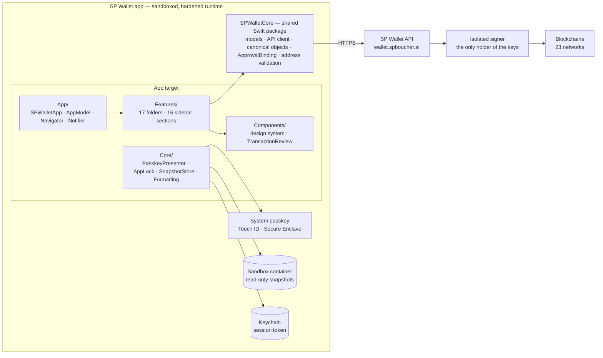
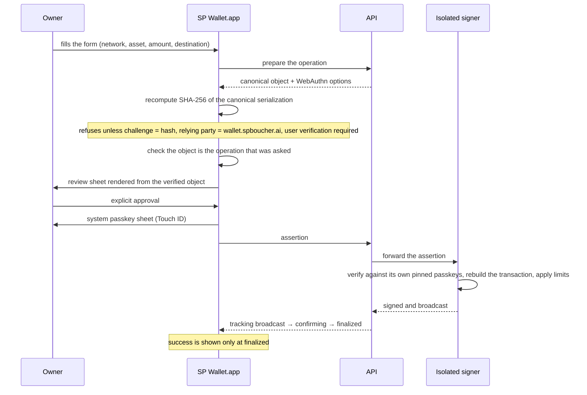

<div align="center">


<br><br>


# SP Wallet for macOS

**The native macOS client of the private multi-chain wallet wallet.spboucher.ai — it displays, prepares and
carries the owner's passkey approvals, and verifies by itself what every approval signs. It never holds a private
key or a recovery phrase. Swift 6, SwiftUI and AppKit, no web view.**

**Author: [Simon-Pierre Boucher](https://www.spboucher.ai)**

[](https://wallet.spboucher.ai)
-5b8cff?style=for-the-badge)


-F05138?style=flat-square&logo=swift&logoColor=white)


[](https://git.spboucher.ai/sp-wallet-macos/commits)
[](https://git.spboucher.ai/sp-wallet-macos/commits)
[](https://git.spboucher.ai/sp-wallet-macos/insights)
[](https://git.spboucher.ai/sp-wallet-macos)
[](https://git.spboucher.ai/sp-wallet-macos/insights)
[](https://git.spboucher.ai/sp-wallet-macos)
[](https://git.spboucher.ai/sp-wallet-macos/branches)
[](https://git.spboucher.ai/sp-wallet-macos/tags)
[](https://git.spboucher.ai/sp-wallet-macos)


</div>

---

## Table of contents

- [Overview](#-overview)
- [Features](#-features)
- [Architecture](#-architecture)
- [Stack](#-stack)
- [Repository layout](#-repository-layout)
- [Build, test, release](#-build-test-release)
- [Configuration](#-configuration)
- [Screens](#-screens)
- [Local data](#-local-data)
- [Security and privacy](#-security-and-privacy)
- [Testing](#-testing)
- [Release](#-release)
- [Writing a feature](#-writing-a-feature)
- [Troubleshooting and gotchas](#-troubleshooting-and-gotchas)
- [Known limitations](#-known-limitations)
- [Documentation](#-documentation)
- [Author](#-author)
- [License](#-license)

---

## 🎯 Overview

Native macOS client (Swift 6, SwiftUI, AppKit — no web view) of the private multi-chain wallet
**wallet.spboucher.ai**. The isolated signer of the MacLustr cluster remains the only holder of the keys: this app
displays, prepares and carries the owner's passkey approvals; it never holds a private key or a recovery phrase.

- Bundle `ai.spboucher.spwallet`, macOS 15+, universal, App Sandbox + Hardened Runtime, Developer ID, notarized.
- Development variant **SP Wallet Dev** (`ai.spboucher.spwallet.dev`): local throwaway stack only, software passkey,
  self-test. None of that code exists in the Release binary.
- Engine room: the shared Swift package `../SPWalletCore` (models, API client, canonical objects and passkey
  binding, address validation), also used by the iOS app. It lives next to this repository, not inside it.
- The interface is in French; code, identifiers and comments are in English.

### Family

| App | Platform | Repository | Role |
|---|---|---|---|
| **SP Wallet** | Web + API — `wallet.spboucher.ai` | [git.spboucher.ai/sp-wallet](https://git.spboucher.ai/sp-wallet) | Backend, web app and isolated signer (the only holder of the keys) |
| **SP Wallet for macOS** (this repository) | macOS 15+ native | [git.spboucher.ai/sp-wallet-macos](https://git.spboucher.ai/sp-wallet-macos) | Native client: display, preparation, verified passkey approvals |

---

## ✨ Features

The full parity matrix — 38 features, each with the backend status, the production status and what was really
verified in the native app — is [`docs/FEATURE_MATRIX.md`](docs/FEATURE_MATRIX.md). Verification levels used there:
**E2E** (exercised by the signed development variant against a throwaway stack), **Seen** (screen observed loading
live data), **Built** (compiled, flow not executed), **Prod** (observed against production). Nothing was executed
with real funds.

### Wallet

| Feature | Native app | Verification |
|---|---|---|
| **Networks** — 23: 8 EVM, BTC/LTC/DOGE/BCH, Solana, TRON, XRPL, Stellar, Cosmos, Sui, Aptos, NEAR, TON, Cardano, Polkadot Asset Hub | Portfolio: id, native coin, address, balances, RPC state, capabilities; registry-driven | E2E (23 networks, 23 addresses) |
| **Tokens** — 84 symbols, server-side verified registry | Assets list and detail, contract, decimals, price chart; states that custom tokens are not supported | E2E / Seen |
| **Balances and prices** | Exact on-chain amounts; fiat always "≈ estimation"; stale / divergent / unavailable flags | E2E |
| **Send** (all networks) | Form → draft → verified intent → review → passkey → tracking to finality | E2E incl. finalization, tampered intent, cancelled passkey, replay |
| **Receive** | Addresses, local QR, payment URI | Seen |
| **Activity** | Table, search, filters, CSV + PDF export, explorer links | E2E (history) / Built (exports) |
| **Audit journal** (hash chain) | Displayed with the server's integrity verdict | Seen |
| **Offline mode** | Read-only consultation of the last snapshots, dated, behind the Mac owner's authentication; no operation | E2E |
| **Portfolio value history** | Local series of this Mac's own observations, labelled (not served by the backend) | Seen |

### Operations

| Feature | Native app | Verification |
|---|---|---|
| **Swaps** — KyberSwap (8 EVM), Jupiter (Solana) | Quotes stream, executable vs comparison-only routes, verified intent review, tracking | Seen (quotes UI); execution Built |
| **Native cross-chain swaps** (THORChain) | Integrated in Swap; failure-closed explained | Built |
| **Bridge** — Circle CCTP V2 (7 EVM + Solana) | Both speeds, two legs, recovery (finish / retry-mint / reclaim / token account) with verified objects | Built |
| **Any-to-any plans** (≤ 3 legs) | DeFi → plan flow, one passkey per leg | Built |
| **NFT** inventory, item pages, media proxy | Gallery, collections, item page, ImageIO decoding, proxy-only media | Seen |
| **NFT transfers** (ERC-721/1155, 4 Solana standards) | Verdict → verified NFT intent → passkey → tracking | Built |
| **NFT market read** | Started by a button, labelled observed data | Built |
| DeFi lending / staking / LP / dApp connection | Stated as not available; no placeholder | — |

### Trading

| Feature | Native app | Verification |
|---|---|---|
| **Derivatives market data** (Hyperliquid, GMX, dYdX, edgeX) | Markets table, instrument page, book, funding, live quote stream | Seen (235 instruments, live stream) |
| **Paper accounts** | Separate SIMULATION mode | Built |
| **Hyperliquid live** (manual, passkey per order) | Account, authorization, pre-trade risk panel, verified order object, collateral | Built — not validated end to end |
| **GMX v2** | Read + reduce / halt / revoke only; opening absent | Built |
| **Risk engine, limits, kill switch** | View, engage (no passkey), release / loosen by passkey over verified objects | Built; kill-switch bar Seen |
| **Spot trading agents** (research / paper / real by mandate) | List, detail, create, lifecycle, mandate approval with risk acknowledgements, revoke, vault | Seen (list, engine status); flows Built |
| **Perp agents** | Paper + live by mandate | Built |
| **Market making** | Paper, evidence, pull / flatten; live approval not offered | Built |
| **Trading API** (keys, webhooks, usage) | Keys with passkey approvals, one-time secret sheet, webhooks, usage | Built |
| **Research** — markets explorer, candles, data quality | Explorer, local indicators labelled derived | Seen (911 markets) |
| **Automated research jobs** | Create with budgets, live log, results labelled AI analysis | Built |

### Monitoring and security

| Feature | Native app | Verification |
|---|---|---|
| **Alerts** (66 kinds), settings, webhook | List, live stream, macOS notifications, settings | Seen (live stream) |
| **Monitoring** (capital, PnL, exposure, health, capabilities) | Per-section failure states, three books apart | Built |
| **Passkey authentication** (WebAuthn) | System passkey sheet (AuthenticationServices) | Prod: Touch ID passkey sign-in confirmed by the owner (2026-11-18) |
| **App lock** (Touch ID) | Optional, authorizes nothing | Built |
| **Isolated signer, limits, anti-replay, expiry** | Never bypassed; limits and key id displayed read-only | E2E |
| **Emergency halt** | Confirmation dialog, one-way explained | Built |
| Owner setup, recovery phrase | Not in the app, by design (signer CLI only) | — |

---

## 🏗 Architecture



### The authorization path



- A compromised API or network path cannot make this app ask the passkey to sign something other than what is on
  screen. An object the app cannot recompute is never approved (`ApprovalError.unsupported` → the UI states it,
  with no bypass).
- Screens receive `let model: AppModel` as a parameter (never `@Environment(AppModel.self)`: it crashes on macOS 27
  inside Table cells, sheets, menus, toolbars).
- Capabilities come from the server: a feature the server reports as off is shown as off with the server's reason.
  No list of networks, markets or venues is hard-coded.
- Reference implementation of a complete operation flow: `Features/Send/SendFlow.swift` (state machine,
  idempotency key, lost-answer recovery without signing twice, tracking until terminal).

---

## 🧱 Stack

| Layer | Technology | Version / setting | Role |
|---|---|---|---|
| Language | Swift | 6.0, `SWIFT_STRICT_CONCURRENCY: complete` | Everything |
| UI | SwiftUI (+ AppKit where needed) | `@Observable`, SwiftUI `Table` for long lists | Shell, 16 sections |
| Charts | Swift Charts | — | Prices, value history, research |
| Auth | AuthenticationServices | — | System passkey sheet |
| Lock | LocalAuthentication (Touch ID) | optional | Local app lock, authorizes nothing |
| Images | ImageIO / NSImage | — | NFT media, never executed |
| Shared core | `SPWalletCore` (local Swift package `../SPWalletCore`) | — | Models, API client, canonical serializations, approval binding, address validation |
| Tests | Swift Testing | hosted in the development variant | App unit tests |
| Project | XcodeGen (`project.yml`) | — | Generates the Xcode project |
| Minimum system | macOS | 15.0 | — |

---

## 🗂 Repository layout

```
sp-wallet-macos/
├── project.yml                # XcodeGen: app SPWallet (Release "SP Wallet", Debug "SP Wallet Dev") + SPWalletTests
├── App/                       # 9 files · 754 lines — shell and state
│   ├── SPWalletApp.swift, AppDelegate.swift, RootView.swift
│   ├── AppModel.swift, AppEnvironment.swift, Navigator.swift, Notifier.swift
│   └── DevHarness.swift, DevSelfTest.swift      # development variant only (#if SPW_DEV)
├── Core/                      # 7 files · 416 lines — app-side adapters
│   ├── Authentication/        #   PasskeyPresenter, DevPasskey
│   ├── Security/AppLock.swift
│   ├── Persistence/           #   SnapshotStore, ValueHistory
│   └── Models/                #   ErrorText, Formatting
├── Components/                # 7 files · 643 lines — design system and the transaction review
│   └── Theme, BalanceCard, AssetRow, TransactionRow, NetworkPicker, SecurityIndicator, TransactionReview
├── Features/                  # 80 files · 19 375 lines — one folder per sidebar section
│   ├── Dashboard/, Portfolio/, Assets/, Send/, Receive/
│   ├── Swap/, Bridge/, NFTs/ (8 files), DeFi/
│   ├── Futures/ (13 files), TradingAgents/ (17 files), Research/ (12 files)
│   ├── Alerts/ (11 files), Activity/, Security/, Settings/
│   ├── Gate/                  #   sign-in screen
│   └── _Pending.swift
├── Resources/                 # Info.plist, Info-Dev.plist, entitlements (Release / Dev), Assets.xcassets
├── Scripts/                   # provision, build, tests, dev run, release, verification, notarization
├── Tests/FormattingTests.swift
└── docs/                      # FEATURE_MATRIX, SECURITY_AUDIT, TEST_REPORT, FEATURE_GUIDE, brand/
```

---

## 🛠 Build, test, release

```bash
python3 Scripts/provision.py          # bundle ids, Associated Domains, Developer ID profiles (existing certificate and API key)
Scripts/build.sh Debug                # development variant
Scripts/t.sh                          # unit tests
SPW_NATIVE_PORT=8760 ../SPWalletCore/Scripts/dev-stack.sh up-fork     # throwaway backend (test keys, Base = local fork)
Scripts/run-dev.sh --selftest         # end-to-end checks of the signed app   (--section <name> --shot out.png for a capture)
Scripts/release.sh && Scripts/verify-release.sh && Scripts/notarize.sh        # dist/SP Wallet.app, dist/SPWallet-<version>.dmg
```

| Script | Purpose |
|---|---|
| `Scripts/provision.py`, `Scripts/asc.py` | Register the bundle identifiers (release and development variants), the Associated Domains capability and the Developer ID provisioning profiles with the existing App Store Connect API key. Idempotent; no certificate is ever created; nothing secret is printed |
| `Scripts/build.sh [Debug\|Release] [derived-data-suffix]` | Generates the Xcode project and builds (errors only on the console). Products go outside `~/Desktop`. Several builds may run at once when each uses its own suffix; project generation is serialized |
| `Scripts/t.sh [derived-data-suffix]` | App unit tests (Swift Testing, hosted in the development variant), signed ad hoc without the hardened runtime |
| `Scripts/run-dev.sh [--section <name>] [--selftest] [--halt] [--shot out.png] [--keep]` | Launches **SP Wallet Dev** against the local throwaway stack. The app is copied out of DerivedData to `~/Applications/SPWalletDev` so that it never runs from `~/Desktop` |
| `Scripts/release.sh` | Release archive signed with the existing Developer ID Application identity and profiles → `dist/SP Wallet.app` |
| `Scripts/verify-release.sh` | 23 checks on the signed application |
| `Scripts/notarize.sh` | Notarizes and staples the app, then builds, signs, notarizes and staples the DMG |
| `Scripts/make-icon.sh` · `window-shot.swift` | Renders the icon SVG into the AppIcon set (needs `rsvg-convert`) · window capture helper |

---

## ⚙️ Configuration

| Setting | Where | Meaning |
|---|---|---|
| Bundle identifiers | `project.yml` | Release `ai.spboucher.spwallet` ("SP Wallet") · Debug `ai.spboucher.spwallet.dev` ("SP Wallet Dev") · tests `ai.spboucher.spwallet.tests` |
| `SPW_DEV` | compilation condition, Debug only | Guards every development-only code path; `verify-release.sh` fails the release if any of its strings is found in the Release binary |
| `SPW_NATIVE_PORT` | environment | Port of the local throwaway stack (`8760` in the documented recipe) |
| `NOTARY_PROFILE` | environment | Existing `notarytool` keychain profile used by `Scripts/notarize.sh` |
| Entitlements (Release) | `Resources/SPWallet.entitlements` | App Sandbox, outgoing network, user-selected read-write files, Associated Domains `webcredentials:wallet.spboucher.ai`, Keychain access group |
| Info.plist | `Resources/Info.plist`, `Resources/Info-Dev.plist` | Category `public.app-category.finance`; Touch ID usage description |
| Signing | `project.yml` | Manual, Developer ID Application, `--timestamp`, hardened runtime |

---

## 🖥 Screens

16 sidebar sections in four groups (`App/Navigator.swift`); titles are those of the French interface.

| Group | Section | Title in the app | Read-only (available offline) |
|---|---|---|---|
| Portefeuille | `dashboard` | Tableau de bord | yes |
| Portefeuille | `portfolio` | Portefeuille | yes |
| Portefeuille | `assets` | Actifs | yes |
| Portefeuille | `send` | Envoyer | — |
| Portefeuille | `receive` | Recevoir | yes |
| Opérations | `swap` | Échanger | — |
| Opérations | `bridge` | Pont inter-chaînes | — |
| Opérations | `nfts` | NFT | yes |
| Opérations | `defi` | DeFi | — |
| Trading | `futures` | Contrats à terme | — |
| Trading | `agents` | Agents de trading | — |
| Trading | `research` | Recherche | — |
| Suivi | `alerts` | Alertes | — |
| Suivi | `activity` | Activité | yes |
| Suivi | `security` | Sécurité | — |
| Suivi | `settings` | Réglages | — |

Plus the sign-in screen (`Features/Gate/GateView.swift`).

---

## 🗄 Local data

| Item | Where | Protection |
|---|---|---|
| Private keys, seed, recovery phrase | **nowhere** — the app has no code path to them; the API exposes no route | — |
| Session token | Keychain (data-protection keychain, `WhenUnlockedThisDeviceOnly`, not synchronized) | Erased at sign-out and when the server refuses it |
| Read-only snapshots (balances, public addresses, history, NFT lists), value history | Sandbox container, complete file protection, excluded from backups | Erased by "Se déconnecter et effacer" |
| Passkey | The system (iCloud Keychain / Secure Enclave) — never visible to the app | System |
| Trading-API secrets shown once | Memory only, for the lifetime of the sheet | Never written |

---

## 🔐 Security and privacy

Full review: [`docs/SECURITY_AUDIT.md`](docs/SECURITY_AUDIT.md). No independent audit or penetration test has been
performed on this client.

- **The app verifies what it asks the passkey to sign.** It recomputes SHA-256 of the canonical serialization
  itself (`SPWalletCore`: byte-for-byte ports verified against 100 vectors generated by the backend's own
  TypeScript for 28 domains) and refuses to continue unless the challenge equals that hash, the relying party is
  `wallet.spboucher.ai` and user verification is required (`ApprovalBinding.verify`).
- **The review sheet renders the fields of the verified object**, never the server's summary: full addresses,
  exact base-unit amounts, fee ceiling, contracts called and spend approvals (`Components/TransactionReview.swift`).
- **The signer stays the last line**: it verifies the assertion against the passkeys it pinned itself, rebuilds
  the transaction from the same fields and applies its limits.
- **The local app lock (Touch ID) authorizes nothing.**
- **Platform hardening**: App Sandbox (outgoing network + user-selected files only), Hardened Runtime, no JIT /
  unsigned-memory / library-validation exception, no web engine linked, ATS without exception in Release, redirects
  not followed by the API client, CSRF header + exact `Origin` on every state-changing call, associated domain
  limited to `webcredentials:wallet.spboucher.ai`, explorer links restricted to `https`, CSV export neutralizes
  formula injection, logs carry no token, address or amount at public privacy level.
- **Remote content is untrusted**: NFT media only through the backend's media proxy, decoded with ImageIO, never
  executed.
- **Product rules** ([`docs/FEATURE_GUIDE.md`](docs/FEATURE_GUIDE.md)): never invent data (unknown is shown as
  unavailable, never as zero); never infer success ("broadcast" is not "confirmed"); simulation / paper / testnet /
  real are visually distinct and never added together; risk is spelled out before any leveraged or automated action.

Known limits: the passkey sheet of macOS shows the domain, not the transaction (the binding is verified by the app,
not displayed by the system); a swapped app binary defeats client-side verification — distribution is Developer ID
signed and notarized, and the signer's limits remain the last line.

---

## 🧪 Testing

| Suite | Result | How |
|---|---|---|
| App unit tests (`Tests/FormattingTests.swift`) | 8 / 8 | `Scripts/t.sh` |
| End-to-end self-test of the **signed, sandboxed** development variant against a throwaway stack (real API, real isolated-signer process, random test keys, Base = local fork) | **25 / 25** | `Scripts/run-dev.sh --selftest` |
| Release verification | 23 checks pass | `Scripts/verify-release.sh` |
| Notarization | App and DMG Accepted, stapled; `spctl`: Notarized Developer ID | `Scripts/notarize.sh` |
| Touch ID passkey sign-in against production (installed 1.0.0) | Works — confirmed by the owner on 2026-11-18 | owner |

<details>
<summary><b>The 25 end-to-end checks</b></summary>

Session · 23 networks · 23 signer addresses · portfolio without invented balance · signer reachable / not halted ·
session token in the keychain · bad checksum / own address / excess decimals refused locally · transfer prepared and
verified · intent equals the form · challenge equals the intent hash · tampered intent refused · cancelled passkey
signs nothing · approval · tracking `broadcast → confirming → finalized` read from the chain · no success before
`finalized` · replay refused · snapshot written · sign-out closes the session and removes the token · offline data
kept · API refuses after sign-out · sign-in again.

</details>

Measured on the development variant: idle CPU 0.0 %, resident memory ≈ 137 MB with the dashboard open.

**Not verified** ([`docs/TEST_REPORT.md`](docs/TEST_REPORT.md)): every operation flow outside transfers (swap,
bridge, cross-chain swap, plans, NFT transfer, derivative orders, authorizations, collateral, mandates, API keys,
research jobs) is compiled and its screens were seen loading live data, but none was executed; nothing with real
funds or on a real venue account; the emergency-halt scripted check, macOS notifications delivery, PDF/CSV exports
through the save panel, the app lock, VoiceOver, an Intel Mac, macOS 15, a second Mac. No XCUITest suite exists; the
UI was checked by window captures of 13 sections.

---

## 📦 Release

| Item | Value |
|---|---|
| Version | 1.0.0 (1) — tag `v1.0.0` |
| Bundle identifier | `ai.spboucher.spwallet` |
| Signing | Developer ID Application, manual, provisioning profile "SP Wallet Developer ID", `--timestamp` |
| Notarization | Application and disk image **Accepted**, stapled |
| Artifacts | `dist/SP Wallet.app`, `dist/SPWallet-<version>.dmg` (not tracked in git) |
| Architecture | Universal (`ONLY_ACTIVE_ARCH: NO` in Release) |

`Scripts/verify-release.sh` checks the signed application: signature, hardened runtime, sandbox and entitlements,
embedded profile, no web engine, no debug entitlement, no development code or test server, no secret in the bundle.
The release scripts never create, print or modify credentials.

---

## 🧩 Writing a feature

[`docs/FEATURE_GUIDE.md`](docs/FEATURE_GUIDE.md) holds the conventions. In short:

- Every operation that moves funds or grants authority goes through the Core's verified approval path: prepare →
  `VerifiedApproval` → review sheet rendering the verified object + `BindingProof` → explicit button → passkey.
  Nothing is ever triggered by merely viewing a quote, a market or a screen. No auto-approve.
- Building blocks in `Components/`: `Page`, `Card`, `Field`, `Banner`, `ProvenanceTag`, `EmptyState`, `StatusPill`,
  `ReviewLines`, `TransactionReview`, `BindingProof`, `ProposalStatusView`, `NetworkPicker`, `Fmt.*`.
- State: `@Observable` classes; network calls through the Core's async APIs; polling stops when the view
  disappears; streams are preferred for live market data.
- Development-only code is inside `#if SPW_DEV`. File header on every file (author, path, description).

---

## 🩺 Troubleshooting and gotchas

| Topic | Explanation |
|---|---|
| **`../SPWalletCore` missing** | The shared package is a sibling directory of this repository; the project does not build without it |
| **Hosted unit tests** | The test build is signed ad hoc without the hardened runtime: an injected test bundle is refused by a hardened Developer ID host |
| **Never run from `~/Desktop`** | Build products go to `~/Library/Developer/SPWallet/`; the development app is copied to `~/Applications/SPWalletDev` |
| **Parallel builds** | Use one DerivedData suffix per build (`Scripts/build.sh Debug <suffix>`); project generation is serialized |
| **`@Environment(AppModel.self)`** | Crashes on macOS 27 inside Table cells, sheets, menus, toolbars: pass `model` explicitly |
| **An operation "cannot be verified"** | The Core threw `ApprovalError.unsupported`: the app cannot recompute the object and offers no way around it, by design |
| **Self-test `--halt`** | It halts the throwaway signer for good (the halt is one-way from clients): do not run it on a shared stack |
| **Web Push** | Subscriptions are a browser feature: listed and removable here, not creatable from a native app |

---

## 🧭 Known limitations

Not built in 1.0.0 (documented, no placeholder in the app): market-making live approval · mandate creation for an
API key · API-key expiry editing · editing spot agent limits after creation · GMX opening orders and GMX
authorization · editing keyed risk limits · NFT floor-estimate opt-in · offline cache of derivatives / monitoring /
research data · automatic update of the app.

Not available on the backend, and stated as such in the app: DeFi lending / staking / LP / dApp connection · NFT
market write, item valuation, Ordinals transfer · dYdX and edgeX trading (market data only) · custom tokens.

---

## 📚 Documentation

| Document | Content |
|---|---|
| [`docs/FEATURE_MATRIX.md`](docs/FEATURE_MATRIX.md) | Parity with the backend, feature by feature, with what was really verified |
| [`docs/SECURITY_AUDIT.md`](docs/SECURITY_AUDIT.md) | What the client holds, the authorization path, hardening, known limits |
| [`docs/TEST_REPORT.md`](docs/TEST_REPORT.md) | What was run, results, what was not verified |
| [`docs/FEATURE_GUIDE.md`](docs/FEATURE_GUIDE.md) | Conventions for writing a feature |

---

## 👤 Author

<div align="center">
<br>

**Simon-Pierre Boucher** — design, development, operations<br>
[www.spboucher.ai](https://www.spboucher.ai) · [git.spboucher.ai](https://git.spboucher.ai) · contact@spboucher.ai

</div>

---

## 📄 License

All rights reserved © 2026 Simon-Pierre Boucher.
